<!-- Every picture here is drawn by build/ (in the profile repo) from the content of nugrahalabib.com:
     same hero, mascot, numbers, logo wall and journey. Edit build/content.mjs, then run build.mjs and readme.mjs. -->

<a href="https://nugrahalabib.com"><picture><source media="(prefers-color-scheme: dark)" srcset="assets/header-dark.svg"></picture></a>

  <a href="https://nugrahalabib.com"><picture><source media="(prefers-color-scheme: dark)" srcset="assets/link-site-dark.svg"></picture></a>
  <a href="https://www.linkedin.com/in/nugrahalabib/"><picture><source media="(prefers-color-scheme: dark)" srcset="assets/link-linkedin-dark.svg"></picture></a>
  <a href="mailto:nugrahalabib@gmail.com"><picture><source media="(prefers-color-scheme: dark)" srcset="assets/link-email-dark.svg"></picture></a>
  <a href="https://www.tiktok.com/@nugrahalabib"><picture><source media="(prefers-color-scheme: dark)" srcset="assets/link-tiktok-dark.svg"></picture></a>
  <a href="https://instagram.com/nugrahalabib"><picture><source media="(prefers-color-scheme: dark)" srcset="assets/link-instagram-dark.svg"></picture></a>

<picture><source media="(prefers-color-scheme: dark)" srcset="assets/heatmap-dark.svg"></picture>

<picture><source media="(prefers-color-scheme: dark)" srcset="assets/about-dark.svg"></picture>

<picture><source media="(prefers-color-scheme: dark)" srcset="assets/partners-dark.svg"></picture>

<picture><source media="(prefers-color-scheme: dark)" srcset="assets/section-work-dark.svg"></picture>

  <a href="https://github.com/nugrahalabib/spead-ai-showcase"><picture><source media="(prefers-color-scheme: dark)" srcset="assets/card-spead-ai-dark.svg"></picture></a>
  <a href="https://github.com/nugrahalabib/agentbuff-showcase"><picture><source media="(prefers-color-scheme: dark)" srcset="assets/card-agentbuff-dark.svg"></picture></a>

  <a href="https://github.com/nugrahalabib/spead-pro-wika-showcase"><picture><source media="(prefers-color-scheme: dark)" srcset="assets/card-spead-pro-wika-dark.svg"></picture></a>
  <a href="https://github.com/nugrahalabib/wika-hc-platform-showcase"><picture><source media="(prefers-color-scheme: dark)" srcset="assets/card-hc-platform-dark.svg"></picture></a>

  <a href="https://github.com/nugrahalabib/wika-q-nexus-showcase"><picture><source media="(prefers-color-scheme: dark)" srcset="assets/card-q-nexus-dark.svg"></picture></a>
  <a href="https://github.com/nugrahalabib/agentbuff-pos-showcase"><picture><source media="(prefers-color-scheme: dark)" srcset="assets/card-agentbuff-pos-dark.svg"></picture></a>

  <a href="https://github.com/nugrahalabib/AgentBuff-Presentation-Skills"><picture><source media="(prefers-color-scheme: dark)" srcset="assets/card-presentation-skills-dark.svg"></picture></a>
  <a href="https://github.com/nugrahalabib/AgentBuff-Co-Founder"><picture><source media="(prefers-color-scheme: dark)" srcset="assets/card-co-founder-dark.svg"></picture></a>

  <a href="https://github.com/nugrahalabib/Future-Companion"><picture><source media="(prefers-color-scheme: dark)" srcset="assets/card-future-companion-dark.svg"></picture></a>
  <a href="https://github.com/nugrahalabib/Website-Berseni.id"><picture><source media="(prefers-color-scheme: dark)" srcset="assets/card-berseni-dark.svg"></picture></a>

<picture><source media="(prefers-color-scheme: dark)" srcset="assets/more-toggle-dark.svg"></picture>

  <a href="https://github.com/nugrahalabib/wika-pms-showcase"><picture><source media="(prefers-color-scheme: dark)" srcset="assets/card-dashpro-dark.svg"></picture></a>
  <a href="https://github.com/nugrahalabib/agentbuff-bym-showcase"><picture><source media="(prefers-color-scheme: dark)" srcset="assets/card-bym-dark.svg"></picture></a>

  <a href="https://github.com/nugrahalabib/agentbuff-tuya-showcase"><picture><source media="(prefers-color-scheme: dark)" srcset="assets/card-smart-home-dark.svg"></picture></a>
  <a href="https://github.com/nugrahalabib/agentbuff-kostcloud-showcase"><picture><source media="(prefers-color-scheme: dark)" srcset="assets/card-kostcloud-dark.svg"></picture></a>

  <a href="https://github.com/nugrahalabib/Linky-Agentbuff"><picture><source media="(prefers-color-scheme: dark)" srcset="assets/card-linky-dark.svg"></picture></a>
  <a href="https://github.com/nugrahalabib/FinFreedom"><picture><source media="(prefers-color-scheme: dark)" srcset="assets/card-finfreedom-dark.svg"></picture></a>

  <a href="https://github.com/nugrahalabib/Agentbuff-Absentra"><picture><source media="(prefers-color-scheme: dark)" srcset="assets/card-absentra-dark.svg"></picture></a>
  <a href="https://github.com/nugrahalabib/AgentBuff-AntiKebo"><picture><source media="(prefers-color-scheme: dark)" srcset="assets/card-antikebo-dark.svg"></picture></a>

  <a href="https://github.com/nugrahalabib/ANRI-Project"><picture><source media="(prefers-color-scheme: dark)" srcset="assets/card-anri-dark.svg"></picture></a>
  <a href="https://github.com/nugrahalabib/web-portfolio-3.0"><picture><source media="(prefers-color-scheme: dark)" srcset="assets/card-portfolio-dark.svg"></picture></a>

<picture><source media="(prefers-color-scheme: dark)" srcset="assets/activity-dark.svg"></picture>

<picture><source media="(prefers-color-scheme: dark)" srcset="assets/principles-dark.svg">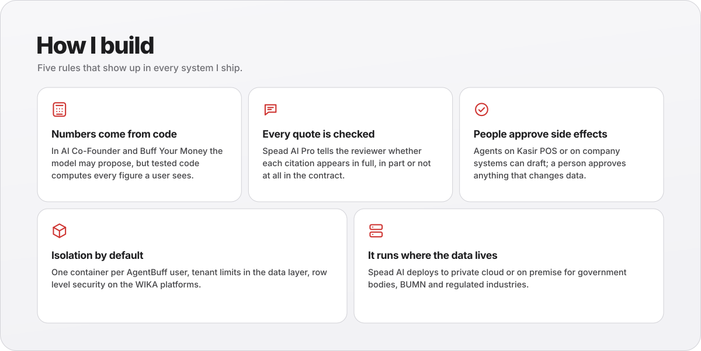</picture>

<picture><source media="(prefers-color-scheme: dark)" srcset="assets/journey-dark.svg"></picture>

<a href="mailto:nugrahalabib@gmail.com"><picture><source media="(prefers-color-scheme: dark)" srcset="assets/contact-dark.svg"></picture></a>

  <a href="https://nugrahalabib.com"><picture><source media="(prefers-color-scheme: dark)" srcset="assets/link-site-dark.svg"></picture></a>
  <a href="https://www.linkedin.com/in/nugrahalabib/"><picture><source media="(prefers-color-scheme: dark)" srcset="assets/link-linkedin-dark.svg"></picture></a>
  <a href="mailto:nugrahalabib@gmail.com"><picture><source media="(prefers-color-scheme: dark)" srcset="assets/link-email-dark.svg"></picture></a>
  <a href="https://www.tiktok.com/@nugrahalabib"><picture><source media="(prefers-color-scheme: dark)" srcset="assets/link-tiktok-dark.svg"></picture></a>
  <a href="https://instagram.com/nugrahalabib"><picture><source media="(prefers-color-scheme: dark)" srcset="assets/link-instagram-dark.svg"></picture></a>

